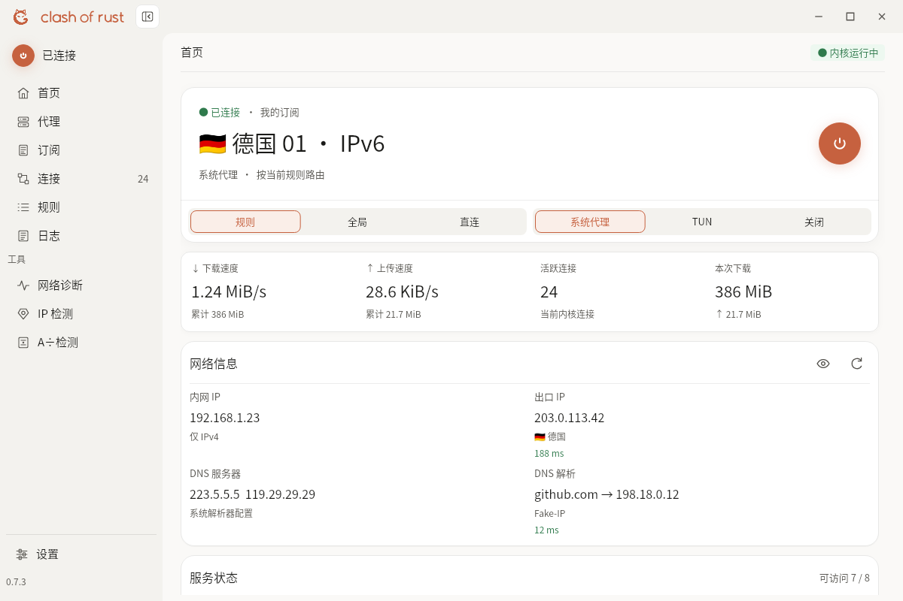
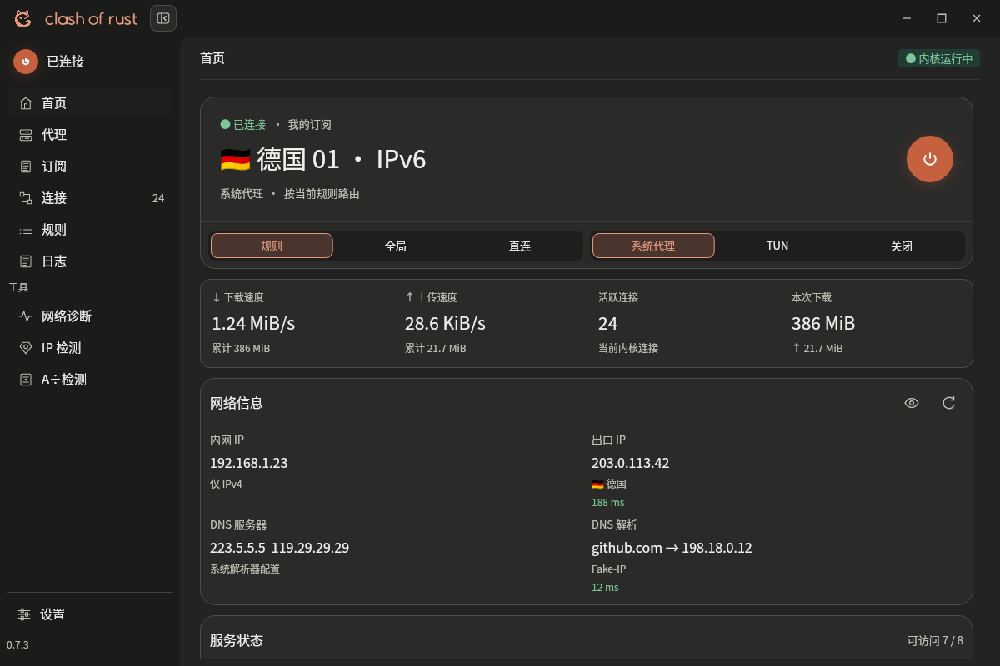
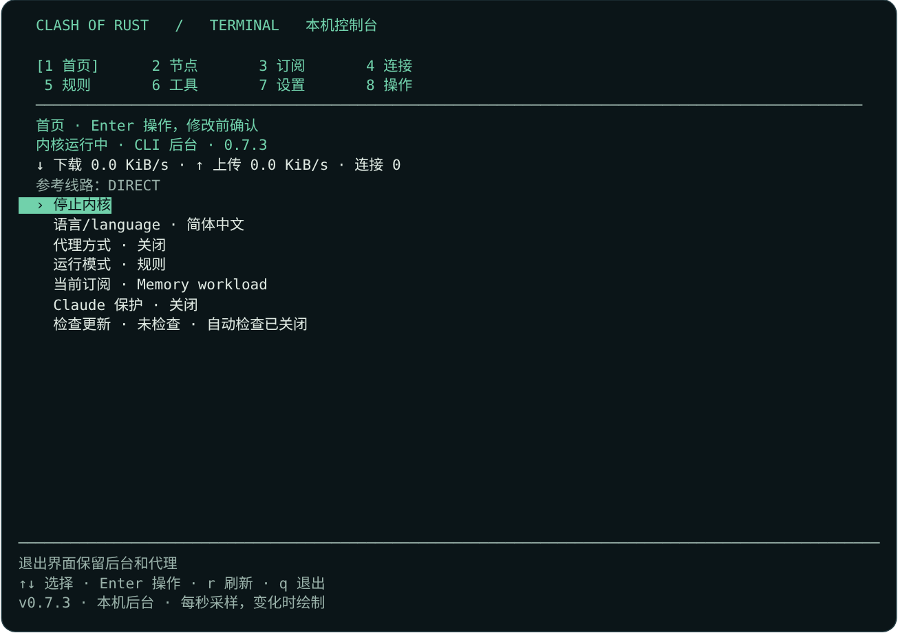

<p align="center">
  
</p>
<h1 align="center">
  <picture>
    <source media="(prefers-color-scheme: dark)" srcset="resources/icons/wordmark-dark.svg">
    
  </picture>
</h1>

<p align="center">
  <a href="README.md" lang="zh-CN">简体中文</a>
</p>
<p align="center">Native UI · Command line · Per-app routing · Network diagnostics</p>
<p align="center">
  <a href="https://github.com/Fu021/Clash-of-Rust/releases/latest"></a>
  <a href="https://github.com/Fu021/Clash-of-Rust/releases"></a>
  <a href="https://github.com/Fu021/Clash-of-Rust/actions/workflows/ci.yml"></a>
  <a href="https://github.com/Fu021/Clash-of-Rust/releases"></a>
</p>
<p align="center">
  <a href="https://clash-of-rust.fu021.shop/en/"></a>
  <a href="https://clash-of-rust.fu021.shop/en/download"></a>
</p>

Clash of Rust is a native proxy client built with **Rust + Slint + mihomo**. The desktop GUI, TUI, and `cor` command line share a backend. Android has a dedicated client.

The table lists supported installs and tested environments for **stable release 0.7.3**.

| Platform | Supported installs | Tested environments |
| --- | --- | --- |
| Windows | x64 / ARM64 | Windows Server 2025 (x64), Windows 11 (x64 / ARM64) |
| Linux | DEB and RPM (x64 / ARM64), native Arch (x64) | Ubuntu 20.04+, Debian, Linux Mint, Pop!_OS, Zorin OS, Fedora, openSUSE, Arch Linux |
| macOS | 14+, Intel / Apple Silicon | macOS 15.7.9 (Intel), 26.7.2 (Apple Silicon) |
| Android | 8.0+, ARM64 / ARMv7 / x86_64 | Android 8.0 through 16 (11 x86_64 emulator versions) |

## Features

| Feature | What you can do |
| --- | --- |
| 🖥️ Native interface | English and Simplified Chinese, light and dark themes, accent colors, grid and list views, and layouts for phones and tablets. |
| ⌨️ Command line | Run headless on Windows, Linux, and macOS. Manage the client over SSH. |
| 📱 Per-app routing | Include or exclude Android apps. Android 10+ can assign an app to a direct connection, policy group, or node. |
| 🌐 Network diagnostics | Check exit IPs and connectivity to GitHub, AI services, and streaming platforms. Filter, rerun, and export reports. |
| 🛡️ Claude protection | Check region, DNS, WebRTC, and project configuration. Protection locks node and network changes, enables TUN and encrypted DNS, and blocks anomalous connections. Disabling it restores settings. |
| 📦 Bundled resources and updates | Includes mihomo and Geo data. Client and Geo downloads show progress and can be canceled. Installer SHA256 is verified. Desktop can switch back to stable, and Android prompts for installation approval. |
| ⚙️ Everyday use | Switch nodes and view speeds in the tray. Supports autostart, a single instance, and window position recall. Closing the window ends the UI process. DNS overrides let you manage Fake-IP and exclusions. |

## Interface Preview

Desktop component previews and an actual terminal frame from an isolated 0.7.3 test.

| Home screen, light theme | Home screen, dark theme |
| --- | --- |
| [](website/src/assets/app-home.png) | [](docs/images/home-0.7.3-dark.png) |

| TUI home screen |
| :---: |
| [](docs/images/tui-0.7.3.png) |

## Installation and Usage

The table links to stable version 0.7.3. Find `.sha256` files and other versions on the [download page](https://clash-of-rust.fu021.shop/en/download) and in [GitHub Releases](https://github.com/Fu021/Clash-of-Rust/releases).

| Platform | Installers and download counts |
| --- | --- |
| Windows | [][windows-x64] [][windows-x64]<br>[][windows-arm64] [][windows-arm64] |
| Linux | [][linux-deb-x64] [][linux-deb-x64]<br>[][linux-deb-arm64] [][linux-deb-arm64]<br>[][linux-rpm-x64] [][linux-rpm-x64]<br>[][linux-rpm-arm64] [][linux-rpm-arm64]<br>[][linux-arch-x64] [][linux-arch-x64] |
| macOS | [][macos-arm64] [][macos-arm64]<br>[][macos-x64] [][macos-x64] |
| Android | [][android-arm64] [][android-arm64] (most phones and tablets)<br>[][android-armv7] [][android-armv7]<br>[][android-x64] [][android-x64] |

[windows-x64]: https://github.com/Fu021/Clash-of-Rust/releases/download/v0.7.3/Clash-of-Rust-0.7.3-windows-x64-setup.exe
[windows-arm64]: https://github.com/Fu021/Clash-of-Rust/releases/download/v0.7.3/Clash-of-Rust-0.7.3-windows-arm64-setup.exe
[linux-deb-x64]: https://github.com/Fu021/Clash-of-Rust/releases/download/v0.7.3/Clash-of-Rust-0.7.3-linux-amd64.deb
[linux-deb-arm64]: https://github.com/Fu021/Clash-of-Rust/releases/download/v0.7.3/Clash-of-Rust-0.7.3-linux-arm64.deb
[linux-rpm-x64]: https://github.com/Fu021/Clash-of-Rust/releases/download/v0.7.3/Clash-of-Rust-0.7.3-linux-x86_64.rpm
[linux-rpm-arm64]: https://github.com/Fu021/Clash-of-Rust/releases/download/v0.7.3/Clash-of-Rust-0.7.3-linux-aarch64.rpm
[linux-arch-x64]: https://github.com/Fu021/Clash-of-Rust/releases/download/v0.7.3/Clash-of-Rust-0.7.3-linux-x86_64.pkg.tar.zst
[macos-arm64]: https://github.com/Fu021/Clash-of-Rust/releases/download/v0.7.3/Clash-of-Rust-0.7.3-macos-arm64.dmg
[macos-x64]: https://github.com/Fu021/Clash-of-Rust/releases/download/v0.7.3/Clash-of-Rust-0.7.3-macos-x64.dmg
[android-arm64]: https://github.com/Fu021/Clash-of-Rust/releases/download/v0.7.3/Clash-of-Rust-0.7.3-android-arm64.apk
[android-armv7]: https://github.com/Fu021/Clash-of-Rust/releases/download/v0.7.3/Clash-of-Rust-0.7.3-android-armv7.apk
[android-x64]: https://github.com/Fu021/Clash-of-Rust/releases/download/v0.7.3/Clash-of-Rust-0.7.3-android-x64.apk

On Windows, run the installer. On Linux, choose a DEB, RPM or native Arch package for your distribution and follow the [installation steps](https://clash-of-rust.fu021.shop/en/download#linux). On macOS, drag the app from the DMG to Applications. On Android, install the APK and approve the first VPN connection. You can add a toggle to Quick Settings.

Open the app, import a subscription on the Subscriptions page, and select a node on the Proxies page. From Home, enable System Proxy or TUN. On Android, connect to the VPN from Home.

Upgrades preserve subscriptions and settings. The Windows uninstaller keeps data by default and offers an option to delete it. If Defender raises an alert, use PowerShell's `Get-FileHash` to compare the installer with the published SHA256. Pause installation if the hash differs or the alert remains unresolved.

## Command Line

Desktop installers include `cor`. Run `cor` in an interactive terminal to open the terminal interface, `cor start` to start the backend, and `cor help` for available commands. On servers, run `cor proxy tun` to enable TUN. The first use may require system authorization.

When working with an AI agent, ask it to run `cor agent guide` first. The Windows installer adds `cor` to PATH by default. On macOS, launch the app once from Applications to configure PATH for your user. Open a new login shell to run `cor`.

## Memory Usage

Measured on **0.7.3** using a release build on Ubuntu 22.04 x64 with Xvfb/X11. The profile had 100 nodes, 5 policy groups and 1,000 rules. Proxying and scheduled latency checks were off, and there was no application traffic. Values in MiB are observed 10-second peaks while the interface is open and resident readings about 60 seconds into each background scenario.

| Scenario | Client RSS | Client PSS | Combined client and core PSS |
| --- | ---: | ---: | ---: |
| GUI home screen, tray available | 56.39 | 46.70 | 94.57 |
| GUI closed, tray still running | 22.69 | 17.76 | 65.64 |
| GUI closed after 20 reopen cycles | 23.87 | 18.95 | 72.68 |
| First open of the TUI home screen | 31.00 | 15.85 | 59.53 |
| TUI exited after browsing pages | 17.12 | 13.44 | 60.57 |
| TUI exited after 20 reopen cycles | 17.15 | 13.46 | 62.77 |
| Headless CLI backend running | 16.48 | 12.79 | 56.44 |

Client columns include the backend and any open GUI or TUI. The combined column adds the core. Closing the GUI or exiting the TUI ends the interface process. The backend and core keep running, and their combined PSS stays above the headless CLI baseline.

Other pages and quick-rule scenarios follow.

| Scenario | Client RSS | Client PSS | Combined client and core PSS |
| --- | ---: | ---: | ---: |
| Proxy groups collapsed | 55.20 | 45.57 | 97.47 |
| Node search | 61.02 | 51.39 | 104.74 |
| Back to the home screen after searching | 56.92 | 47.29 | 100.65 |
| Home screen with all five quick rules enabled | 54.44 | 44.66 | 109.90 |

RSS counts shared pages in full. PSS counts a proportional share. These are short Linux measurements. Actual usage varies with device, configuration and traffic. [Raw 0.7.3 benchmark results](https://github.com/Fu021/Clash-of-Rust/actions/runs/45788967631).

## Building and Packaging

### Local Build

Install stable Rust, Python 3.11+, and your platform's native tools. Windows uses MSVC. Linux needs C/C++ tools, pkg-config, and development libraries for GLib, Fontconfig/FreeType, XKB, and Wayland/X11. macOS uses the Xcode Command Line Tools. Run these commands from the repository root.

```sh
python3 scripts/prepare-resources.py
cargo build --target-dir target/desktop -p clash-of-rust -p clash-desktop-ui -p clash-cli --bins --locked
```

Desktop binaries go into `target/desktop/debug/`. Core and Geo resources go into `bundle/`. Keep the desktop host and UI executable in the same directory. On Windows, you can use `python` for the first command.

### GitHub Actions

[CI](https://github.com/Fu021/Clash-of-Rust/actions/workflows/ci.yml) builds and verifies six desktop targets and three Android ABIs. Open **Artifacts** on the successful run and download the `package-*` archive for your platform. It contains the installer and `.sha256` file. **Publish Release** can reuse those artifacts to verify the installers in `check_only` mode.

## Contributing

Use the [issue forms](https://github.com/Fu021/Clash-of-Rust/issues/new/choose) to report problems or suggest improvements. To report a failure, export diagnostics from the error notification or Logs page, or run `cor diagnose --output cor-diagnose.json`. Review the JSON before attaching it to the form. AI-assisted PRs are welcome. Run the applicable local checks before submitting.

Find detailed usage and development material in the [documentation index](docs/README.md).

## License

Original code uses [GPL-3.0-only](LICENSE). IP checks reused or derived from RegionRestrictionCheck retain [AGPL-3.0-only](resources/ip-check/SOURCE.md). The combined distribution follows section 13 of GPLv3 and AGPLv3, including offering complete corresponding source to remote network users where applicable. mihomo and Slint are used under GPL-3.0. See the [third-party notices](resources/THIRD-PARTY-NOTICES.txt) for other sources.
