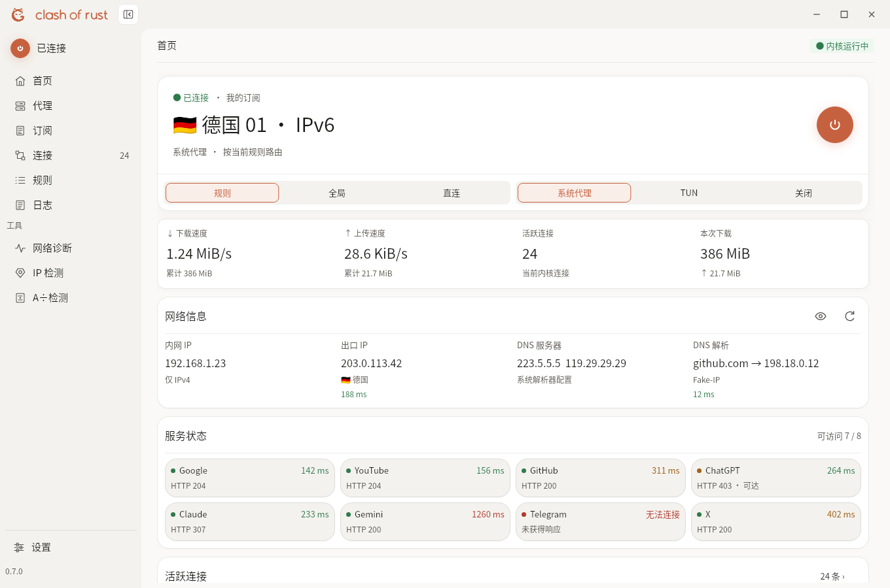
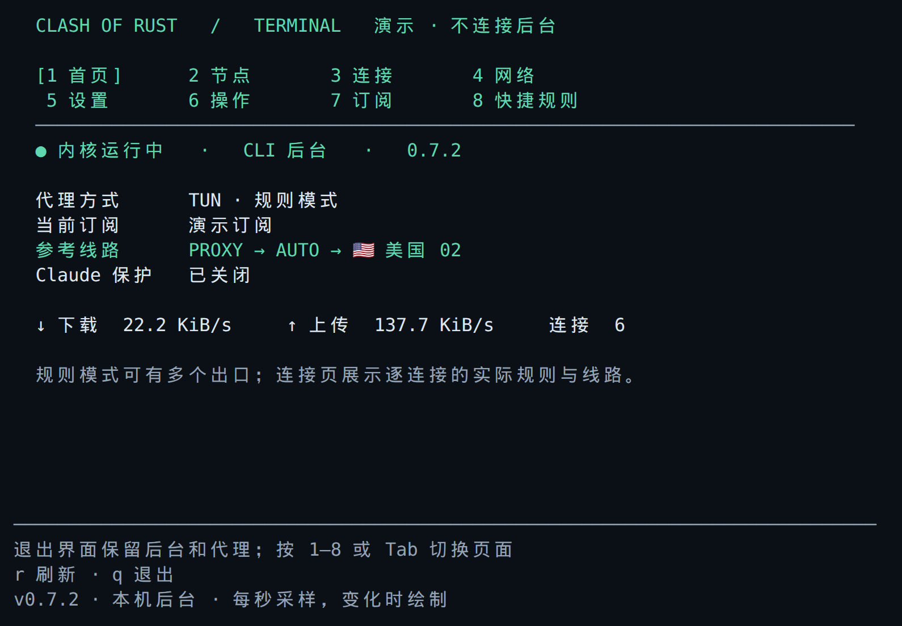

  

<h1 align="center">
  <picture>
    <source media="(prefers-color-scheme: dark)" srcset="resources/icons/wordmark-dark.svg">
    
  </picture>
</h1>

  <a href="README.md" lang="zh-CN">简体中文</a>

  <a href="https://clash-of-rust.fu021.shop/en/download">Download</a> ·
  <a href="https://clash-of-rust.fu021.shop/en/start">Quick start</a> ·
  <a href="https://github.com/Fu021/Clash-of-Rust/releases/latest">Latest stable release</a>

Clash of Rust is a native proxy client built with Rust, Slint, and mihomo. On desktop, its GUI, terminal UI, and `cor` CLI share a backend and configuration. Android runs its own native app.

## Features

- **Proxy management** with subscriptions, policy groups, custom rules, latency tests, and system proxy or TUN mode.
- **Android per-app routing** with app inclusion and exclusion. Android 10 and later can also assign apps to direct connections, policy groups, or individual nodes. See the [Android routing reference (Chinese)](docs/android-application-routing.md).
- **Network diagnostics** for IP addresses, DNS, and access to AI, streaming, and other services, with filterable results and diagnostic export. See the [network tools guide](https://clash-of-rust.fu021.shop/en/tools).
- **Claude checks and protection** for reviewing connection, DNS, browser, and project settings. Protection pins the active node and applies TUN, encrypted DNS, and connection safeguards. Disabling it restores the previous settings. See the [Claude protection reference (Chinese)](docs/claude-protection.md).
- **Updates** for the app and bundled Geo data. Desktop users can opt into pre-releases or switch back to stable. Android uses the system installer.

## Install

Choose the package for your platform and architecture. Download pages include SHA-256 checksums. See [Downloads](https://clash-of-rust.fu021.shop/en/download) and [GitHub Releases](https://github.com/Fu021/Clash-of-Rust/releases).

| Platform | Packages | Installation |
| --- | --- | --- |
| Windows | x64 and ARM64 | Run the setup executable. |
| Debian and Ubuntu 20.04+ | DEB for amd64 and ARM64 | Run `sudo apt install ./package.deb` with your downloaded filename. |
| macOS 14+ | DMG for Intel and Apple Silicon | Open the DMG and drag the app to Applications. |
| Android 8.0+ | APK for ARM64, ARMv7, and x86_64 | Install the APK and approve the VPN request on first connection. |

The Android host guide lists the systems and device types covered by testing. See [Android compatibility and verification (Chinese)](apps/android/README.md#兼容性与验证范围).

## Choose an interface

- **Desktop GUI** for subscriptions, proxy controls, and diagnostics. See the [desktop guide](https://clash-of-rust.fu021.shop/en/guide).
- **Terminal UI** with `cor ui`. See the [TUI guide](https://clash-of-rust.fu021.shop/en/tui).
- **Command line** with `cor start` to start the backend and `cor help` to list commands. See the [CLI guide](https://clash-of-rust.fu021.shop/en/cli).

| Desktop GUI | Terminal UI |
| --- | --- |
|  |  |

## Build and contribute

Desktop builds use the Rust toolchain and platform libraries. Android has a separate build and test entry point. See [local development (Chinese)](docs/workflows/local-development.md), [Android development (Chinese)](apps/android/README.md#本地构建), and [the documentation index (Chinese)](docs/README.md).

Report a problem or request a feature using the [bilingual Issue forms](https://github.com/Fu021/Clash-of-Rust/issues/new/choose). For a problem report, include reproduction steps and attach your diagnostic JSON after reviewing it for private information. See [diagnostic export (Chinese)](docs/cli/runtime.md#故障反馈与诊断报告).

Before contributing code, run the relevant local checks and read the [contribution guidelines (Chinese)](.github/CONTRIBUTING.md).

## License

The original client code is GPL-3.0-only. The IP tests derived from RegionRestrictionCheck are AGPL-3.0-only. The combined distribution follows section 13 of the GPLv3 and AGPLv3. See [LICENSE](LICENSE), [IP test sources and licensing](resources/ip-check/SOURCE.md), and [third-party notices](resources/THIRD-PARTY-NOTICES.txt).
