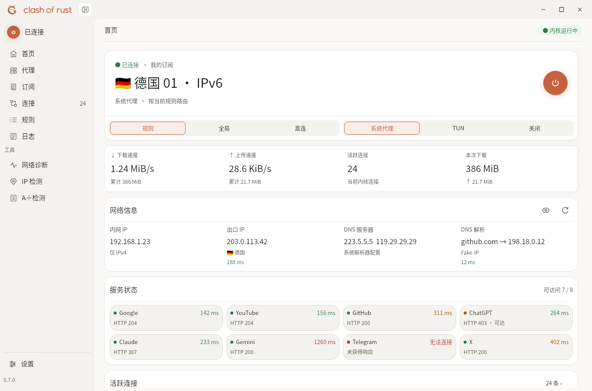
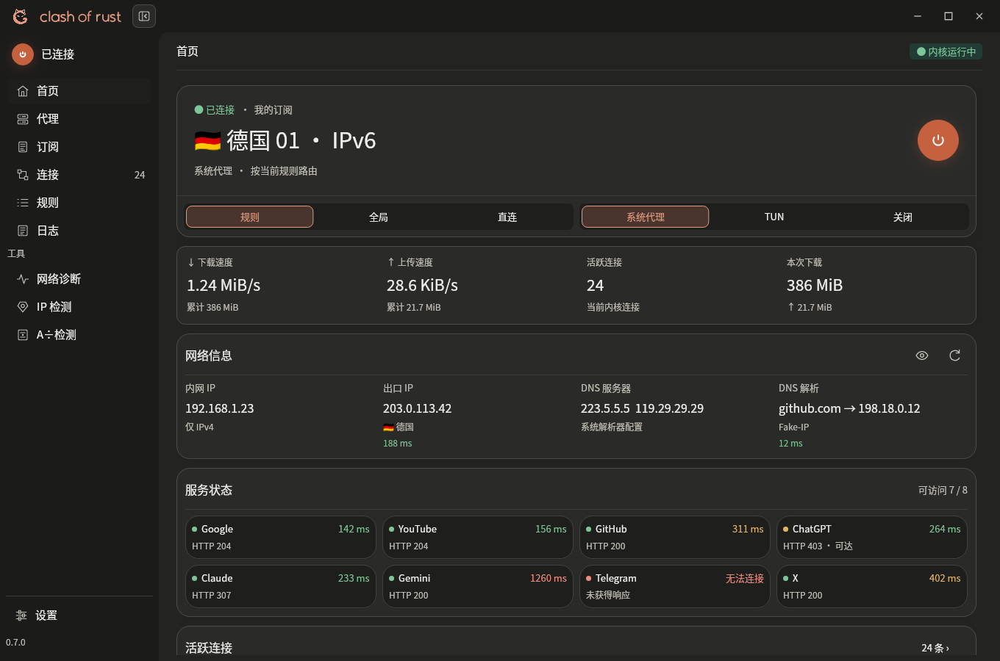

<p align="center">
  
</p>
<h1 align="center">
  <picture>
    <source media="(prefers-color-scheme: dark)" srcset="resources/icons/wordmark-dark.svg">
    
  </picture>
</h1>

<p align="center">
  原生界面 · 命令行 · 应用分流 · 网络诊断
</p>
<p align="center">
  <a href="https://github.com/Fu021/Clash-of-Rust/releases/latest"></a>
  <a href="https://github.com/Fu021/Clash-of-Rust/releases"></a>
  <a href="https://github.com/Fu021/Clash-of-Rust/actions/workflows/ci.yml"></a>
  <a href="https://github.com/Fu021/Clash-of-Rust/releases"></a>
</p>
<p align="center">
  <a href="#安装与使用">下载安装</a> ·
  <a href="#界面预览">界面预览</a> ·
  <a href="#命令行">命令行</a> ·
  <a href="docs/README.md">使用与开发文档</a>
</p>

基于 **Rust + Slint + mihomo** 的原生代理客户端，无需 WebView。一个后台连接桌面界面与 `cor` 命令行，Android 使用独立移动宿主。

支持 **Windows（x64 / ARM64）**、**Debian/Ubuntu（amd64 / ARM64，Ubuntu 最低 20.04）**、**macOS 14+（Intel / Apple Silicon）** 和 **Android 8.0+（ARM64 / ARMv7 / x86_64）**。Android 各版本和厂商 ROM 的验证范围见[兼容性说明](apps/android/README.md#兼容性与验证范围)。

当前源码与预发布版本：**0.7.2-fix.2.update-memory**，见[更新内容](docs/releases/0.7.2-fix.2.update-memory.md)；下方下载表提供 **0.7.1 正式版**。

## 功能一览

| 功能 | 能做什么 |
| --- | --- |
| 🖥️ 原生界面 | 浅色与深色主题、强调色、宫格与列表、手机与平板布局；页面数据按需加载。 |
| ⌨️ 命令行 | Windows、Linux、macOS 无界面运行，与窗口共用后台和内核，适用于服务器与 SSH。[使用文档](docs/cli.md) |
| 📱 应用分流 | Android 全部、仅选中或排除应用；Android 10+ 可按应用指定直连、策略组或节点。[配置说明](docs/android-application-routing.md) |
| 🌐 网络检测 | 出口 IP、GitHub、AI 服务与流媒体访问检测，分类报告、筛选与重测；可导出诊断。[诊断说明](docs/diagnostics.md) |
| 🛡️ Claude 保护 | A÷检测汇总地区、DNS、WebRTC 与项目配置线索；保护启用 TUN、加密 DNS 与异常连接拦截，锁定节点及网络修改，关闭后恢复设置。[检测与保护](docs/claude-region-detection.md) |
| 📦 内置资源与更新 | 内置 mihomo 与 Geo 数据；支持 Geo 更新、正式版与预发布版更新、进度与取消，校验安装包 SHA256；桌面可从预发布版切回正式版，Android 安装由系统确认。 |
| ⚙️ 日常使用 | 托盘切换节点与速度显示、后台自启动、单实例、窗口位置记忆；关闭窗口释放界面进程。DNS 覆盖下可独立管理 Fake-IP 及排除项。[界面说明](crates/client-ui/README.md) |

## 界面预览

| 浅色首页 | 深色首页 |
| --- | --- |
| [](docs/images/home-0.7.0-light.png) | [](docs/images/home-0.7.0-dark.png) |

## 安装与使用

从 [GitHub Releases](https://github.com/Fu021/Clash-of-Rust/releases) 下载对应系统和架构的安装包，附带 `.sha256` 校验文件。下表为 0.7.1 正式版链接。

| 平台 | 安装包与下载次数 |
| --- | --- |
| Windows | [](https://github.com/Fu021/Clash-of-Rust/releases/download/v0.7.1/Clash-of-Rust-0.7.1-windows-x64-setup.exe) [](https://github.com/Fu021/Clash-of-Rust/releases/download/v0.7.1/Clash-of-Rust-0.7.1-windows-x64-setup.exe)<br>[](https://github.com/Fu021/Clash-of-Rust/releases/download/v0.7.1/Clash-of-Rust-0.7.1-windows-arm64-setup.exe) [](https://github.com/Fu021/Clash-of-Rust/releases/download/v0.7.1/Clash-of-Rust-0.7.1-windows-arm64-setup.exe) |
| Debian / Ubuntu 20.04+ | [](https://github.com/Fu021/Clash-of-Rust/releases/download/v0.7.1/Clash-of-Rust-0.7.1-linux-amd64.deb) [](https://github.com/Fu021/Clash-of-Rust/releases/download/v0.7.1/Clash-of-Rust-0.7.1-linux-amd64.deb)<br>[](https://github.com/Fu021/Clash-of-Rust/releases/download/v0.7.1/Clash-of-Rust-0.7.1-linux-arm64.deb) [](https://github.com/Fu021/Clash-of-Rust/releases/download/v0.7.1/Clash-of-Rust-0.7.1-linux-arm64.deb) |
| macOS | [](https://github.com/Fu021/Clash-of-Rust/releases/download/v0.7.1/Clash-of-Rust-0.7.1-macos-arm64.dmg) [](https://github.com/Fu021/Clash-of-Rust/releases/download/v0.7.1/Clash-of-Rust-0.7.1-macos-arm64.dmg)<br>[](https://github.com/Fu021/Clash-of-Rust/releases/download/v0.7.1/Clash-of-Rust-0.7.1-macos-x64.dmg) [](https://github.com/Fu021/Clash-of-Rust/releases/download/v0.7.1/Clash-of-Rust-0.7.1-macos-x64.dmg) |
| Android | [](https://github.com/Fu021/Clash-of-Rust/releases/download/v0.7.1/Clash-of-Rust-0.7.1-android-arm64.apk) [](https://github.com/Fu021/Clash-of-Rust/releases/download/v0.7.1/Clash-of-Rust-0.7.1-android-arm64.apk) （多数手机和平板）<br>[](https://github.com/Fu021/Clash-of-Rust/releases/download/v0.7.1/Clash-of-Rust-0.7.1-android-armv7.apk) [](https://github.com/Fu021/Clash-of-Rust/releases/download/v0.7.1/Clash-of-Rust-0.7.1-android-armv7.apk)<br>[](https://github.com/Fu021/Clash-of-Rust/releases/download/v0.7.1/Clash-of-Rust-0.7.1-android-x64.apk) [](https://github.com/Fu021/Clash-of-Rust/releases/download/v0.7.1/Clash-of-Rust-0.7.1-android-x64.apk) |

Windows 运行安装程序；Debian/Ubuntu（Ubuntu 仅支持 20.04 及以上）使用 `sudo apt install ./安装包文件名.deb`。升级保留订阅和个人设置；Windows 卸载可选删除全部配置和数据，默认不勾选。

macOS 打开 DMG，将 **Clash of Rust.app** 拖入 **Applications（应用程序）** 后启动。Android 安装对应架构的 APK，首次连接允许 VPN 授权；可在系统快捷设置中添加开关磁贴。

Windows Defender 若出现告警，请先核对下载文件及 SHA256；扫描记录和微软误报提交入口见 [Defender 告警处理](docs/workflows/release.md#windows-defender-告警)。未知告警不能直接认定为误报。

## 命令行

Windows、Linux、macOS 安装包均附带无界面的 `cor`，与窗口共用后台和内核。运行 `cor start` 启动后台；服务器可启用 TUN 接管流量。运行 `cor help` 查看命令，安装、参数和示例见 [CLI 使用文档](docs/cli.md)。

## 内存占用

实测版本 **0.7.1**（`2658c57`）；Ubuntu 22.04 x64、4 vCPU、Rust 1.99.1、Release 构建、Slint 1.18.1 软件渲染、mihomo v1.19.33。低强度固定输入为 **100 节点、5 个策略组、1,000 条规则**；DNS 覆盖、IPv6 和 UDP 开启，Claude 保护、快捷规则、系统代理和 TUN 关闭，无业务流量。客户端统计包含桌面宿主与独立界面进程：

| 场景 | 客户端 RSS | 客户端 PSS | 客户端与内核合计 PSS |
| --- | ---: | ---: | ---: |
| 首页 | 53.80 MiB | 44.03 MiB | 89.69 MiB |
| 代理组折叠 | 54.23 MiB | 44.46 MiB | 93.70 MiB |
| 节点搜索 | 64.81 MiB | 55.04 MiB | 107.77 MiB |
| 返回首页 | 57.16 MiB | 47.39 MiB | 100.14 MiB |

后台场景使用独立启动的客户端；托盘两项为同一客户端关闭窗口前后，已验证界面进程退出、内核持续运行且窗口可重新打开。纯 CLI 使用 `cor start`：

| 场景 | 客户端 RSS | 客户端 PSS | 客户端与内核合计 PSS |
| --- | ---: | ---: | ---: |
| 首页打开、托盘可用 | 55.15 MiB | 45.11 MiB | 91.19 MiB |
| 关闭窗口、驻留托盘 | 23.10 MiB | 17.86 MiB | 63.94 MiB |
| 纯 CLI 后台运行 | 14.86 MiB | 11.16 MiB | 54.75 MiB |

搜索后关闭窗口，客户端 RSS 为 23.39 MiB、PSS 为 18.15 MiB；连续开关窗口 20 次通过。五项快捷规则全开时，首页客户端 RSS 为 53.10 MiB，合计 PSS 为 105.50 MiB。每场景采样 10 秒、间隔 250 ms，表中为观测峰值；RSS 含共享页，PSS 按比例分摊。实际占用随系统、配置和流量变化。[完整基准与原始数据](https://github.com/Fu021/Clash-of-Rust/actions/runs/43298403773)；与 0.7.0 的对照及分析见[当前内存结果](docs/workflows/memory-current.md)。

## 编译与打包

可选择本地工具链或 GitHub Actions。**本地开发与验证不要求推送代码或触发工作流**；正式发布使用经过 CI 验证的产物。

### 选项一：本地编译与打包

准备 Rust stable、Python 3.11+ 和当前平台的原生工具链：Windows 使用 MSVC；Linux 安装 C/C++、pkg-config、GLib、Fontconfig/FreeType、XKB、Wayland/X11 开发库；macOS 安装 Xcode Command Line Tools。从仓库根目录执行：

```sh
python3 scripts/prepare-resources.py
cargo build -p clash-of-rust -p clash-desktop-ui -p clash-cli --bins --locked
```

桌面宿主、界面程序、`cor` 命令行和网络助手生成在 `target/debug/`，内核与 Geo 资源生成在 `bundle/`；桌面宿主与界面程序需放在同一目录。Windows 可用 `python` 替代 `python3`。需要 Windows EXE、Linux DEB 或 macOS DMG 时，按 [本地打包步骤](docs/workflows/local-development.md#本地打包)生成；Android 本地工具链与 APK 构建见 [Android 开发说明](apps/android/README.md#本地构建)。

### 选项二：GitHub Actions

[CI](https://github.com/Fu021/Clash-of-Rust/actions/workflows/ci.yml) 在提交 PR 或推送 main 后，完成六种桌面平台及三种 Android ABI 的编译、检查、单元测试与代理/TUN 测试。

测试安装包：对应提交的 CI 会生成并验收九组 `package-*` 安装包及 SHA256，保存在 CI 的 Actions 附件中。手动运行 **Publish Release** 并勾选 `check_only` 可再次核对候选包与安装收据，不重新编译或重复安装矩阵；公开发布复用桌面候选包，并对 Android 重新签名和验证。流程见[工作流说明](docs/workflows.md)。

## 开发与发布

按任务查阅[文档导航](docs/README.md)，或从[仓库目录与职责](docs/development.md#目录与职责)定位代码。

共享业务、桌面宿主、独立窗口、CLI 与移动桥接的模块职责和验证要求见 [开发与验证](docs/development.md)；Android 工具链与原生宿主见 [Android 开发说明](apps/android/README.md)，iOS 保留独立界面与宿主占位。

历史提交与 GitHub Actions 常见失败模式按主题整理在 [Agent 失败复盘目录](docs/agent-failures/README.md)。按任务查相关主题，结束时更新[最近复盘](docs/agent-failures/reviews.md)。

构建、验证、缓存和打包脚本的入口与合并规则见 [脚本维护说明](scripts/README.md)；不要为单次操作复制新的包装脚本。

安装 Slint Viewer 后可独立预览界面。资源受限时只做静态检查或最小单页预览，并把输出放到工作区外：

```sh
python3 scripts/preview-slint.py --check
python3 scripts/preview-slint.py --page settings --theme light --output /tmp/clash-slint-preview
```

测试、内存基准与发布流程见 [工作流文档](docs/workflows.md)。

## 参与贡献

欢迎 AI 辅助的 PR；请尽量先在本地完成相关验证，并阅读[贡献者须知](.github/CONTRIBUTING.md)，了解资源受限环境、CI、缓存服务器与工作流变更约定。

## License

Rust 界面及原创通用代码采用 **GPL-3.0-only**，见 [LICENSE](LICENSE)。IP 检测复用的 RegionRestrictionCheck 源码及派生逻辑保留 **AGPL-3.0-only**，见 [授权及修改说明](resources/ip-check/SOURCE.md)；组合发行遵守 GPLv3/AGPLv3 第 13 条，包括适用时向远程网络用户提供完整对应源码。

mihomo 采用 GPL-3.0，Slint 按 GPL-3.0 使用。第三方软件与数据来源见 [THIRD-PARTY-NOTICES.txt](resources/THIRD-PARTY-NOTICES.txt)。
