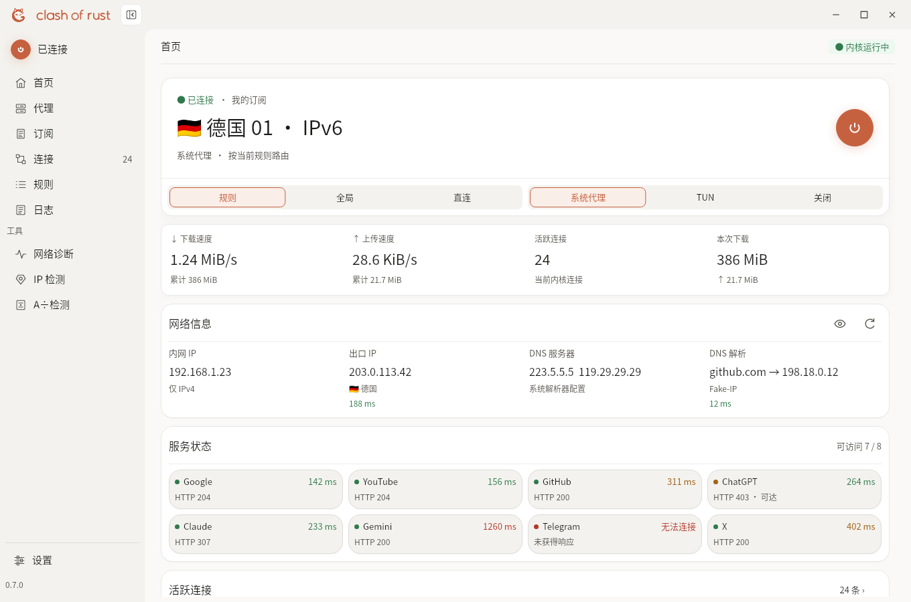
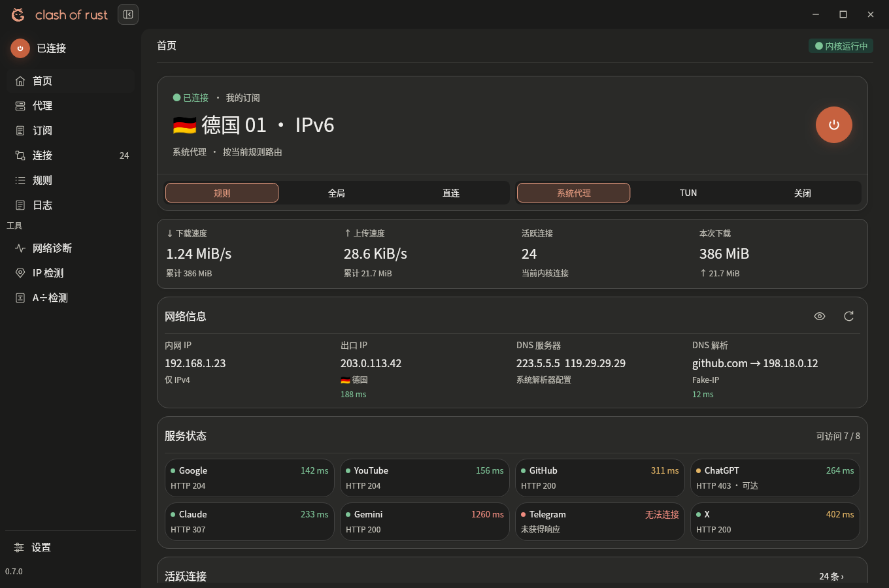
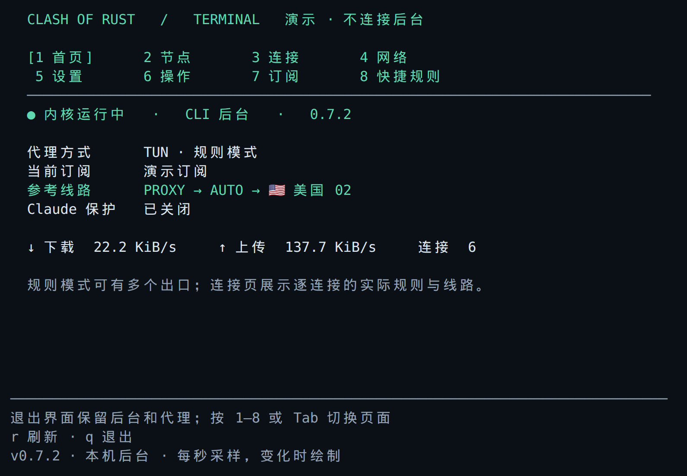

<p align="center">
  
</p>
<h1 align="center">
  <picture>
    <source media="(prefers-color-scheme: dark)" srcset="resources/icons/wordmark-dark.svg">
    
  </picture>
</h1>

<p align="center">
  <a href="README.en.md" lang="en">English</a>
</p>
<p align="center">原生界面 · 命令行 · 应用分流 · 网络诊断</p>
<p align="center">
  <a href="https://github.com/Fu021/Clash-of-Rust/releases/latest"></a>
  <a href="https://github.com/Fu021/Clash-of-Rust/releases"></a>
  <a href="https://github.com/Fu021/Clash-of-Rust/actions/workflows/ci.yml"></a>
  <a href="https://github.com/Fu021/Clash-of-Rust/releases"></a>
</p>
<p align="center">
  <a href="https://clash-of-rust.fu021.shop/"></a>
  <a href="https://clash-of-rust.fu021.shop/download"></a>
</p>
<p align="center">
  <a href="#界面预览">界面预览</a> ·
  <a href="#命令行">命令行</a>
</p>

Clash of Rust 是基于 **Rust + Slint + mihomo** 的原生代理客户端。桌面 GUI、TUI 和 `cor` 命令行共用后台，Android 提供独立客户端。

下表列出 **0.7.2 正式版**的安装范围和实测环境。

| 平台 | 安装支持 | 实测环境 |
| --- | --- | --- |
| Windows | x64 / ARM64 | Windows 桌面版（x64）、Windows 11（ARM64）、Windows Server 2025（x64） |
| Linux | Debian 或 Ubuntu 20.04+，amd64 / ARM64 | Ubuntu 20.04 和 22.04（x64 / ARM64）、24.04 和 26.04（x64） |
| macOS | 14+，Intel / Apple Silicon | macOS 15.7.9（Intel）、26.7.2（Apple Silicon） |
| Android | 8.0+，ARM64 / ARMv7 / x86_64 | Android 8.0 至 16（11 个 x86_64 模拟器版本） |

## 功能一览

| 功能 | 能做什么 |
| --- | --- |
| 🖥️ 原生界面 | 深浅主题、强调色、宫格与列表，适配手机和平板。 |
| ⌨️ 命令行 | 支持 Windows、Linux、macOS 无界面运行，可通过 SSH 操作。 |
| 📱 应用分流 | Android 可纳入或排除应用。Android 10+ 可为单个应用指定直连、策略组或节点。 |
| 🌐 网络检测 | 检查出口 IP 及 GitHub、AI 和流媒体连通性，支持筛选、重测和导出报告。 |
| 🛡️ Claude 保护 | 检查地区、DNS、WebRTC 和项目配置。开启保护后锁定节点和网络修改，启用 TUN、加密 DNS 与异常连接拦截，关闭后恢复设置。 |
| 📦 内置资源与更新 | 内置 mihomo 与 Geo 数据。支持 Geo 和客户端更新、下载进度与取消，并校验安装包 SHA256。桌面可切回正式版，Android 安装需系统确认。 |
| ⚙️ 日常使用 | 托盘切换节点和显示速度，支持后台自启动、单实例及窗口位置记忆。关窗释放界面进程，可在 DNS 覆盖中管理 Fake-IP 和排除项。 |

## 界面预览

| 浅色首页 | 深色首页 |
| --- | --- |
| [](docs/images/home-0.7.0-light.png) | [](docs/images/home-0.7.0-dark.png) |

| TUI 首页 |
| :---: |
| [](docs/images/tui-0.7.2.png) |

## 安装与使用

下表提供 0.7.2 正式版安装包。`.sha256` 校验文件和其他版本见[下载页](https://clash-of-rust.fu021.shop/download)及 [GitHub Releases](https://github.com/Fu021/Clash-of-Rust/releases)。

| 平台 | 安装包与下载次数 |
| --- | --- |
| Windows | [](https://github.com/Fu021/Clash-of-Rust/releases/download/v0.7.2/Clash-of-Rust-0.7.2-windows-x64-setup.exe) [](https://github.com/Fu021/Clash-of-Rust/releases/download/v0.7.2/Clash-of-Rust-0.7.2-windows-x64-setup.exe)<br>[](https://github.com/Fu021/Clash-of-Rust/releases/download/v0.7.2/Clash-of-Rust-0.7.2-windows-arm64-setup.exe) [](https://github.com/Fu021/Clash-of-Rust/releases/download/v0.7.2/Clash-of-Rust-0.7.2-windows-arm64-setup.exe) |
| Debian / Ubuntu 20.04+ | [](https://github.com/Fu021/Clash-of-Rust/releases/download/v0.7.2/Clash-of-Rust-0.7.2-linux-amd64.deb) [](https://github.com/Fu021/Clash-of-Rust/releases/download/v0.7.2/Clash-of-Rust-0.7.2-linux-amd64.deb)<br>[](https://github.com/Fu021/Clash-of-Rust/releases/download/v0.7.2/Clash-of-Rust-0.7.2-linux-arm64.deb) [](https://github.com/Fu021/Clash-of-Rust/releases/download/v0.7.2/Clash-of-Rust-0.7.2-linux-arm64.deb) |
| macOS | [](https://github.com/Fu021/Clash-of-Rust/releases/download/v0.7.2/Clash-of-Rust-0.7.2-macos-arm64.dmg) [](https://github.com/Fu021/Clash-of-Rust/releases/download/v0.7.2/Clash-of-Rust-0.7.2-macos-arm64.dmg)<br>[](https://github.com/Fu021/Clash-of-Rust/releases/download/v0.7.2/Clash-of-Rust-0.7.2-macos-x64.dmg) [](https://github.com/Fu021/Clash-of-Rust/releases/download/v0.7.2/Clash-of-Rust-0.7.2-macos-x64.dmg) |
| Android | [](https://github.com/Fu021/Clash-of-Rust/releases/download/v0.7.2/Clash-of-Rust-0.7.2-android-arm64.apk) [](https://github.com/Fu021/Clash-of-Rust/releases/download/v0.7.2/Clash-of-Rust-0.7.2-android-arm64.apk) （多数手机和平板）<br>[](https://github.com/Fu021/Clash-of-Rust/releases/download/v0.7.2/Clash-of-Rust-0.7.2-android-armv7.apk) [](https://github.com/Fu021/Clash-of-Rust/releases/download/v0.7.2/Clash-of-Rust-0.7.2-android-armv7.apk)<br>[](https://github.com/Fu021/Clash-of-Rust/releases/download/v0.7.2/Clash-of-Rust-0.7.2-android-x64.apk) [](https://github.com/Fu021/Clash-of-Rust/releases/download/v0.7.2/Clash-of-Rust-0.7.2-android-x64.apk) |

Windows 运行安装程序。Debian/Ubuntu 运行 `sudo apt install ./安装包文件名.deb`。macOS 将 DMG 内的应用拖入「应用程序」。Android 安装 APK 后，在首次连接时允许 VPN 授权，可在系统快捷设置中添加开关磁贴。

打开应用后，在「订阅」页导入订阅，在「代理」页选择节点，再从首页启用系统代理或 TUN。Android 从首页连接 VPN。

升级保留订阅和设置。Windows 卸载时默认保留数据，可主动勾选删除。如遇 Defender 告警，用 PowerShell 的 `Get-FileHash` 核对安装包和发布附带的 SHA256。若摘要不匹配或告警未核实，先暂停安装。

## 命令行

桌面安装包均附带 `cor`。运行 `cor start` 启动后台，`cor ui` 打开终端界面，`cor help` 查看命令。在服务器上可运行 `cor proxy tun` 启用 TUN，首次开启可能需要系统授权。

## 内存占用

**0.7.2** 在 Ubuntu 22.04 x64 的 Release 软件渲染实测，配置含 100 个节点、5 个策略组、1,000 条规则，无业务流量。每个场景采样 10 秒，表中为峰值（MiB）。

| 场景 | 客户端 RSS | 客户端 PSS | 客户端与内核合计 PSS |
| --- | ---: | ---: | ---: |
| GUI 首页、托盘可用 | 56.18 | 46.25 | 92.39 |
| 关闭 GUI、驻留托盘 | 23.36 | 18.23 | 64.50 |
| 首次打开 TUI 首页 | 29.42 | 14.86 | 57.74 |
| 浏览各页后关闭 TUI | 18.25 | 14.53 | 61.15 |
| 再次打开 TUI 首页 | 33.71 | 19.12 | 65.74 |
| 再次关闭 TUI | 18.31 | 14.59 | 61.27 |
| 纯 CLI 后台运行 | 15.65 | 11.93 | 54.68 |

客户端列统计后台和当前 GUI/TUI，合计列纳入内核。关窗或退出 TUI 后界面进程结束，后台与内核继续运行。

其他页面与快捷规则场景：

| 场景 | 客户端 RSS | 客户端 PSS | 客户端与内核合计 PSS |
| --- | ---: | ---: | ---: |
| 代理组折叠 | 54.73 | 45.00 | 94.04 |
| 节点搜索 | 65.77 | 56.04 | 108.07 |
| 搜索后返回首页 | 58.01 | 48.28 | 100.70 |
| 五项快捷规则全开：首页 | 55.18 | 45.33 | 109.68 |

RSS 完整计入共享页，PSS 按比例分摊。实际占用随设备、配置和流量变化。[原始基准数据](https://github.com/Fu021/Clash-of-Rust/actions/runs/44103803255)。

## 编译与打包

### 本地编译

准备 Rust stable、Python 3.11+ 和原生工具链。Windows 使用 MSVC，macOS 使用 Xcode Command Line Tools，Linux 需要 C/C++、pkg-config 及 GLib、Fontconfig/FreeType、XKB、Wayland/X11 开发库。在仓库根目录运行以下命令。

```sh
python3 scripts/prepare-resources.py
cargo build --target-dir target/desktop -p clash-of-rust -p clash-desktop-ui -p clash-cli --bins --locked
```

桌面程序生成在 `target/desktop/debug/`，内核与 Geo 资源在 `bundle/`。桌面宿主与界面程序需放在同一目录。Windows 可用 `python` 运行第一条命令。

### GitHub Actions

[CI](https://github.com/Fu021/Clash-of-Rust/actions/workflows/ci.yml) 编译并验证六个桌面目标及三个 Android ABI。通过后打开该次运行的 **Artifacts**，下载对应平台的 `package-*`，内含安装包和 `.sha256`。**Publish Release** 的 `check_only` 模式可复用同提交产物核验安装包。

## 参与贡献

通过 [Issue 表单](https://github.com/Fu021/Clash-of-Rust/issues/new/choose)提交问题或建议。遇到故障，可从报错通知或日志页选择「导出诊断」，也可运行 `cor diagnose --output cor-diagnose.json`。确认 JSON 可分享后，将它附到问题表单。欢迎 AI 辅助的 PR，提交前请完成适用的本地验证。

详细使用和开发资料集中在[文档导航](docs/README.md)。

## License

原创代码采用 [GPL-3.0-only](LICENSE)，复用及派生的 RegionRestrictionCheck IP 检测代码保留 [AGPL-3.0-only](resources/ip-check/SOURCE.md)。组合发行遵守 GPLv3/AGPLv3 第 13 条，包括适用时向远程网络用户提供完整对应源码。mihomo 与 Slint 按 GPL-3.0 使用，其他来源见[第三方声明](resources/THIRD-PARTY-NOTICES.txt)。
