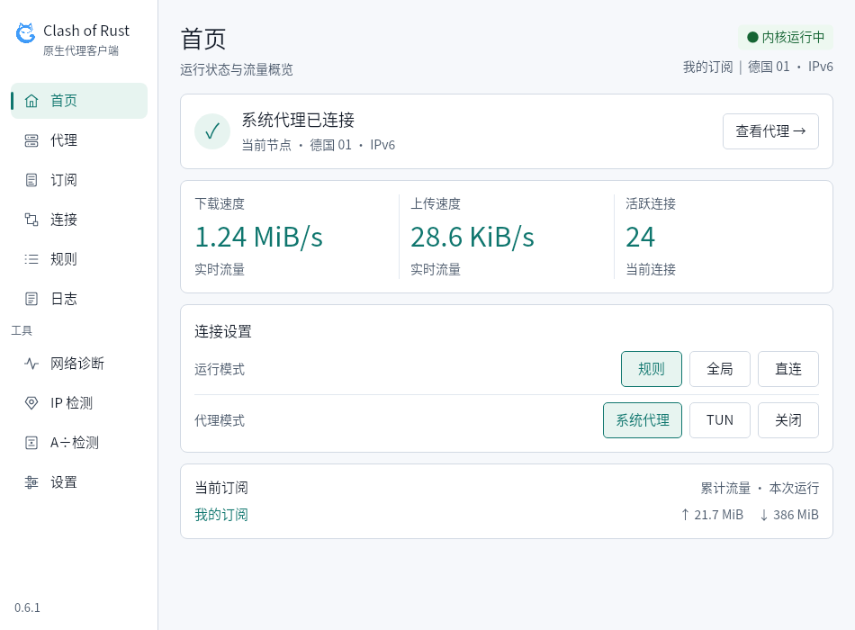
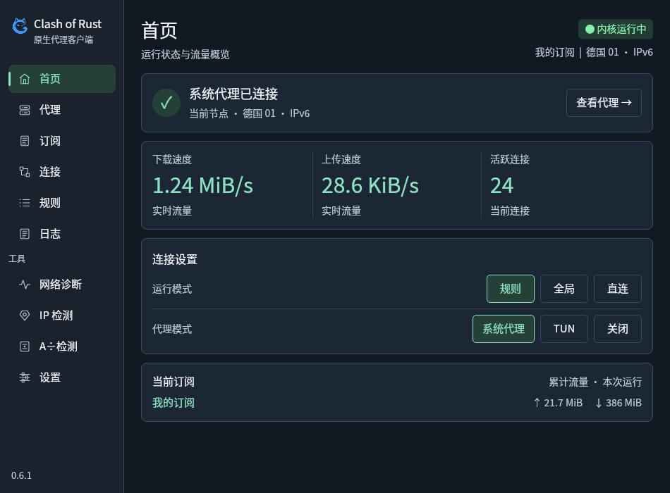

<p align="center">
  
</p>
<h1 align="center">Clash of Rust</h1>

基于 mihomo 的原生 Rust 代理客户端。支持 **Windows（x64 / ARM64）**、**Debian/Ubuntu（amd64 / ARM64，Ubuntu 仅支持 22.04 及以上）**、**macOS 14 及以上（Intel / Apple Silicon）** 和 **Android 8.0 及以上（ARM64 / ARMv7 / x86_64）**。版本 **0.6.1**，更新内容见 [发布说明](docs/releases/0.6.1.md)。

## Features

- **轻量**：Rust + Slint 原生界面，无需 WebView，页面数据按需加载。
- **离线就绪**：内置 mihomo 内核和 Geo 数据，支持一键更新 Geo 数据。
- **IP 检测**：183 个检测项，覆盖出口 IP、GitHub、AI 服务与流媒体地区访问；一键检测显示分类报告，点击分类或状态查看详情，支持筛选与分类重测。
- **A÷检测**：采集 Claude 地区、DNS、WebRTC 与浏览器线索，扫描已记录项目配置并分类展示；可选一键保护，锁定节点及规则/全局模式并启用 TUN、加密 DNS 与异常连接拦截，关闭后恢复原设置，详见 [检测说明](docs/claude-region-detection.md)。
- **便捷使用**：托盘快捷切换节点，可选显示上传与下载速度；支持后台开机自启、单实例与网络诊断，记住普通窗口尺寸；内核启动失败时可直接重试。
- **客户端更新**：仅检查正式版，支持下载进度与取消；校验完成后桌面自动安装与重启，Android 由系统确认安装，失败时显示原因。

| 浅色首页 | 深色首页 |
| --- | --- |
| [](docs/images/home-light.png) | [](docs/images/home-dark.png) |

## 安装与使用

从 [GitHub Releases](https://github.com/Fu021/Clash-of-Rust/releases) 下载当前正式版对应系统和架构的安装包，附带 `.sha256` 校验文件。

| 平台 | 安装包 |
| --- | --- |
| Windows x64 | [Clash-of-Rust-0.6.1-windows-x64-setup.exe](https://github.com/Fu021/Clash-of-Rust/releases/download/v0.6.1/Clash-of-Rust-0.6.1-windows-x64-setup.exe) |
| Windows ARM64 | [Clash-of-Rust-0.6.1-windows-arm64-setup.exe](https://github.com/Fu021/Clash-of-Rust/releases/download/v0.6.1/Clash-of-Rust-0.6.1-windows-arm64-setup.exe) |
| Debian / Ubuntu 22.04+ amd64 | [Clash-of-Rust-0.6.1-linux-amd64.deb](https://github.com/Fu021/Clash-of-Rust/releases/download/v0.6.1/Clash-of-Rust-0.6.1-linux-amd64.deb) |
| Debian / Ubuntu 22.04+ ARM64 | [Clash-of-Rust-0.6.1-linux-arm64.deb](https://github.com/Fu021/Clash-of-Rust/releases/download/v0.6.1/Clash-of-Rust-0.6.1-linux-arm64.deb) |
| macOS Intel | [Clash-of-Rust-0.6.1-macos-x64.dmg](https://github.com/Fu021/Clash-of-Rust/releases/download/v0.6.1/Clash-of-Rust-0.6.1-macos-x64.dmg) |
| macOS Apple Silicon | [Clash-of-Rust-0.6.1-macos-arm64.dmg](https://github.com/Fu021/Clash-of-Rust/releases/download/v0.6.1/Clash-of-Rust-0.6.1-macos-arm64.dmg) |
| Android ARM64（多数手机与平板） | [Clash-of-Rust-0.6.1-android-arm64.apk](https://github.com/Fu021/Clash-of-Rust/releases/download/v0.6.1/Clash-of-Rust-0.6.1-android-arm64.apk) |
| Android ARMv7 | [Clash-of-Rust-0.6.1-android-armv7.apk](https://github.com/Fu021/Clash-of-Rust/releases/download/v0.6.1/Clash-of-Rust-0.6.1-android-armv7.apk) |
| Android x86_64 | [Clash-of-Rust-0.6.1-android-x64.apk](https://github.com/Fu021/Clash-of-Rust/releases/download/v0.6.1/Clash-of-Rust-0.6.1-android-x64.apk) |

Windows 运行安装程序；Debian/Ubuntu（Ubuntu 仅支持 22.04 及以上）使用 `sudo apt install ./安装包文件名.deb`。升级保留订阅和个人设置；Windows 卸载可选删除全部配置和数据，默认不勾选。

macOS 打开 DMG，将 **Clash of Rust.app** 拖入 **Applications（应用程序）** 后启动。Android 安装对应架构的 APK，首次连接允许 VPN 授权；可在系统快捷设置中添加开关磁贴。

可能造成 Windows Defender 误判查杀，需自行规避。

## 命令行

0.6.2 开发版的桌面安装包内附带无界面的 `cor`，支持内核、订阅、节点、规则、连接、日志、IP/Claude 检测与后台服务管理，并与正在运行的窗口共用内核。运行 `cor help` 查看全部命令，`cor help <命令>` 查看参数与示例。安装路径、脚本调用和授权说明见 [CLI 使用文档](docs/cli.md)。

## 内存占用

实测版本 **0.6.1**（`fa3ceef`）；Ubuntu 22.04 x64、Rust 1.99.1、Release 构建、Slint 软件渲染，mihomo v1.19.32；低强度固定输入为 **100 节点、5 个策略组、1,000 条规则**。DNS 覆盖、IPv6 与 UDP 开启，Claude 保护、快捷规则、系统代理和 TUN 关闭，无业务流量：

| 场景 | GUI RSS | GUI 与内核合计 PSS |
| --- | ---: | ---: |
| 首页 | 44.63 MiB | 82.99 MiB |
| 代理组折叠 | 45.43 MiB | 87.77 MiB |
| 节点搜索 | 54.71 MiB | 99.47 MiB |
| 返回首页 | 54.77 MiB | 99.53 MiB |

五项快捷规则全开时，首页 GUI RSS 为 43.58 MiB，合计 PSS 为 98.95 MiB。以上为每场景采样 10 秒、间隔 250 ms 的观测峰值，实际占用随系统、配置和使用情况变化；RSS 含共享页，PSS 按比例分摊共享页。[测试记录](https://github.com/Fu021/Clash-of-Rust/actions/runs/39566842514)。

## 编译与打包

可选择本地工具链或 GitHub Actions。**本地开发与验证不要求推送代码或触发工作流**；正式发布使用经过 CI 验证的产物。

### 选项一：本地编译与打包

准备 Rust stable、Python 3.11+ 和当前平台的原生工具链：Windows 使用 MSVC；Linux 安装 C/C++、pkg-config、GLib、Fontconfig/FreeType、XKB、Wayland/X11 开发库；macOS 安装 Xcode Command Line Tools。从仓库根目录执行：

```sh
python3 scripts/prepare-resources.py
cargo build -p clash-of-rust -p clash-cli --bins --locked
```

桌面程序、`cor` 命令行和网络助手生成在 `target/debug/`，内核与 Geo 资源生成在 `bundle/`。Windows 可用 `python` 替代 `python3`。需要 Windows EXE、Linux DEB 或 macOS DMG 时，按 [本地打包步骤](docs/workflows.md#本地打包)生成；Android 本地工具链与 APK 构建见 [Android 开发说明](apps/android/README.md#本地构建)。

### 选项二：GitHub Actions

[CI](https://github.com/Fu021/Clash-of-Rust/actions/workflows/ci.yml) 在提交 PR 或推送 main 后，完成六种桌面平台及三种 Android ABI 的编译、检查、单元测试与代理/TUN 测试。

测试安装包：等待对应提交的 CI 成功，手动运行 **Publish Release**，填写 `ci_run_id` 并勾选 `check_only`；安装包保存在 Actions 附件中。打包复用 CI 产物，不再编译；正式发布流程见 [工作流说明](docs/workflows.md)。

## 开发与发布

Cargo workspace 分为共享业务（`crates/client-core`）、共享原生运行层（`crates/client-runtime`）、Slint 界面（`crates/client-ui`）、桌面宿主（`apps/desktop`）与命令行（`apps/cli`）。Android 使用独立 Slint 原生宿主与系统 VPN，并通过移动桥接（`crates/mobile-ffi`）复用共享业务，见 [Android 开发说明](apps/android/README.md)；iOS 保留独立界面与宿主占位。

安装 Slint Viewer 后可独立预览界面：

```text
python3 scripts/preview-slint.py --dialogs --pairs
```

测试、内存基准、发布流程及手动验收说明见 [工作流文档](docs/workflows.md)。

## 参与贡献

欢迎 AI 辅助的 PR；请尽量先在本地完成相关验证，并阅读[贡献者须知](.github/CONTRIBUTING.md)，了解 CI、缓存服务器与工作流变更约定。

## License

Rust 界面及原创通用代码采用 **GPL-3.0-only**，见 [LICENSE](LICENSE)。IP 检测复用的 RegionRestrictionCheck 源码及派生逻辑保留 **AGPL-3.0-only**，见 [授权及修改说明](resources/ip-check/SOURCE.md)；组合发行遵守 GPLv3/AGPLv3 第 13 条，包括适用时向远程网络用户提供完整对应源码。

mihomo 采用 GPL-3.0，Slint 按 GPL-3.0 使用。第三方软件与数据来源见 [THIRD-PARTY-NOTICES.txt](resources/THIRD-PARTY-NOTICES.txt)。
